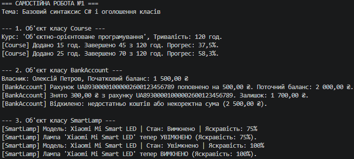

## Висновок

У ході виконання самостійної роботи №1 було закріплено навички створення та моделювання об'єктів реального світу мовою C#:

1. Створено три самостійні класи (`Course`, `BankAccount`, `SmartLamp`), які демонструють різні типи даних, закриті поля, публічні властивості та методи із захистом від некоректних даних.
2. Реалізовано принцип інкапсуляції завдяки приватним полям та закритим/обмеженим сеттерам у властивостях.
3. У файлі `Program.cs` повністю продемонстровано роботу створених класів через виклики методів та виведення результатів у консоль.

