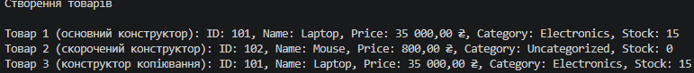

## Висновок

У ході виконання самостійної роботи №2 було закріплено навички використання перевантажених конструкторів мовою C#:

1. Реалізовано клас `Product` із трьома перевантаженими конструкторами (основний, скорочений та конструктор копіювання), що забезпечує гнучкість при створенні об'єктів у різних сценаріях.
2. Застосовано механізм делегування конструкторів за допомогою ключового слова `this(...)`, що дозволило уникнути дублювання коду ініціалізації полів.
3. Забезпечено незмінність (immutability) об'єктів через read-only властивості та перевизначено метод `ToString()` для зручного виведення повної інформації про товар у консоль.

