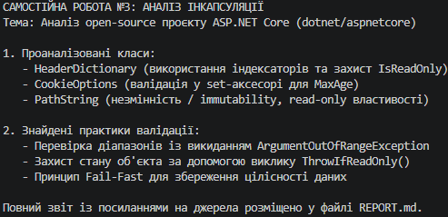

# Звіт з аналізу інкапсуляції в Open-Source проєкті

## 1. Обраний проєкт
- **Назва:** ASP.NET Core (`dotnet/aspnetcore`)
- **Посилання на GitHub:** [https://github.com/dotnet/aspnetcore](https://github.com/dotnet/aspnetcore)

---

## 2. Аналіз інкапсуляції

### Клас 1: `HeaderDictionary`
- **Файл у репозиторії:** [`src/Http/Headers/src/HeaderDictionary.cs`](https://github.com/dotnet/aspnetcore/blob/main/src/Http/Headers/src/HeaderDictionary.cs)
- **Опис класу:** Представляє колекцію HTTP-заголовків запиту/відповіді. Забезпечує роботу з заголовками через індексатори та спеціалізовані властивості.
- **Поля:** Поля класу є повністю закритими (`private` / `internal`), наприклад приватне поле `_headers` для зберігання внутрішнього словника даних.
- **Властивості:** 
  - `Count` — read-only властивість для отримання кількості заголовків.
  - `IsReadOnly` — read-only властивість, що вказує стан колекції.
- **Індексатори:** Клас реалізує індексатор `public StringValues this[string key]` для зручного доступу до заголовків за їх назвою:

```csharp
public StringValues this[string key]
{
    get
    {
        return Store.TryGetValue(key, out var value) ? value : StringValues.Empty;
    }
    set
    {
        ThrowIfReadOnly();
        if (StringValues.IsNullOrEmpty(value))
        {
            Store.Remove(key);
        }
        else
        {
            Store[key] = value;
        }
    }
}
```
