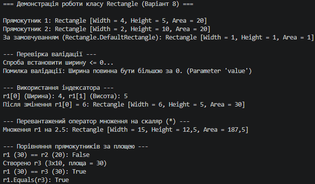

## Висновок

У ході виконання лабораторної роботи №4 було опановано та практично застосовано ключові концепції об’єктно-орієнтованого програмування на мові C#:

1. **Інкапсуляція та валідація даних:** Реалізовано клас `Rectangle` із приватними полями `_width` та `_height`. Завдяки логіці перевірки в сеттерах властивостей `Width` та `Height` забезпечено цілісність даних (заборонено встановлення значень $\le 0$).
2. **Статичні члени:** Використано статичну властивість `DefaultRectangle` для отримання об'єкта із константними значеннями за замовчуванням ($1 \times 1$) без потреби створення додаткових екземплярів через конструктор.
3. **Індексатори:** Реалізовано зручний доступ до розмірів прямокутника за індексами (`[0]` для ширини, `[1]` для висоти), що робить роботу з об'єктом більш гнучкою.
4. **Перевантаження операторів:** 
   * Перевантажено оператор `*` для пропорційного масштабування розмірів прямокутника на скаляр.
   * Перевантажено оператори порівняння `==` та `!=` для зіставлення прямокутників за їхньою площею (`Area`).
5. **Перевизначення методів класу `Object`:** Перевизначено методи `ToString()`, `Equals()` та `GetHashCode()`. Це забезпечило узгоджену поведінку операторів порівняння та коректну роботу об'єктів у колекціях і хеш-таблицях.

Усі реалізовані елементи класу були успішно протестовані в консольному додатку (`Program.cs`).

