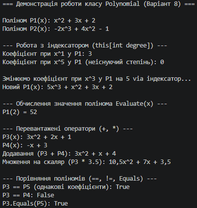

## Висновок

У ході виконання лабораторної роботи №5 було розглянуто та практично застосовано механізми перевантаження операторів та створення індексаторів у C#:

1. **Індексатори:** Реалізовано індексатор `this[int degree]` у класі `Polynomial`, який забезпечує зручний доступ до коефіцієнтів полінома за їхнім степенем, а також динамічно розширює внутрішній масив при спробі запису коефіцієнта для нового степеня.
2. **Перевантаження операторів:** 
   * Реалізовано бінарний оператор `+` для додавання двох поліномів з автоматичним підсумовуванням коефіцієнтів відповідних степенів.
   * Реалізовано оператор `*` для пропорційного множення всіх коефіцієнтів полінома на скаляр.
   * Перевантажено оператори порівняння `==` та `!=` для перевірки рівності двох поліномів.
3. **Цілісність та коректність типів:** Перевизначено методи `Equals()`, `GetHashCode()` та `ToString()`, що забезпечило узгоджену поведінку типів у колекціях та їхнє коректне форматоване відображення у консолі.

Усі реалізовані можливості класу `Polynomial` були успішно продемонстровані в консольному додатку.

