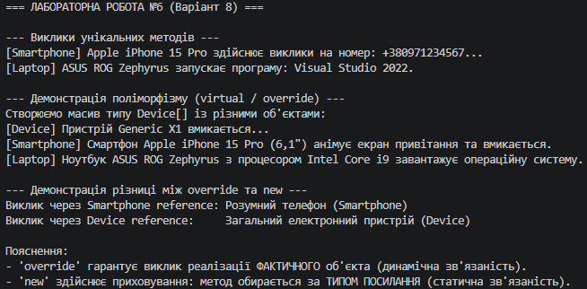

## Висновок

У ході виконання лабораторної роботи №6 було практично опановано механізми наслідування та поліморфізму в C#:

1. **Ієрархія класів:** Створено базовий клас `Device` та похідні класи `Smartphone` і `Laptop`. За допомогою конструктора `base(...)` реалізовано передачу параметрів до базового класу.
2. **Поліморфізм (`virtual` / `override`):** Віртуальний метод `PowerOn()` базового класу був перевизначений у похідних класах. При виклику методу через масив базового типу `Device[]` продемонстровано динамічне зв'язування — кожен об'єкт виконував власну специфічну реалізацію.
3. **Приховування членів (`new`):** Продемонстровано відмінність між `override` та `new` на прикладі методу `GetDeviceType()`. Показано, що при використанні `new` метод обирається на основі типу посилання (статичне зв'язування), а не фактичного типу об'єкта.

Результати роботи підтвердили коректність функціонування створеної ієрархії класів.

