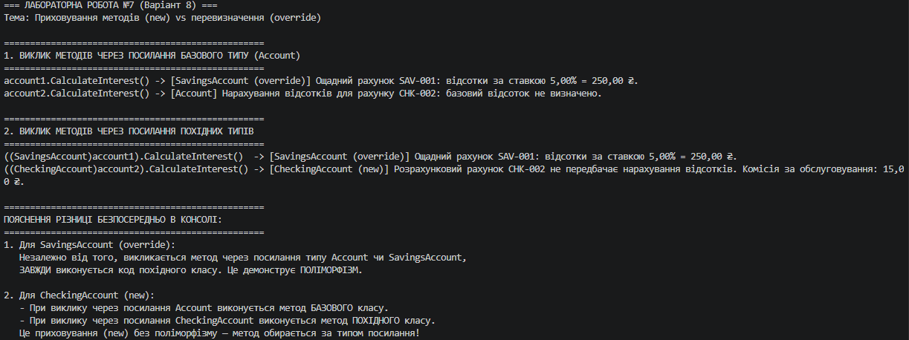

## Висновок

У ході виконання лабораторної роботи №7 було детально досліджено та практично відпрацьовано відмінності між перевизначенням методів (`override`) та їх приховуванням (`new`):

1. **Забезпечення поліморфізму (`override`):** Клас `SavingsAccount` перевизначив віртуальний метод `CalculateInterest()`. При виклику цього методу через посилання базового типу `Account` спрацювала динамічна зв'язаність, і виконався метод похідного класу `SavingsAccount`.
2. **Приховування членів (`new`):** Клас `CheckingAccount` приховав метод `CalculateInterest()` за допомогою модифікатора `new`. При виклику методу через посилання типу `Account` спрацював метод базового класу, а при виклику через посилання `CheckingAccount` — метод похідного класу (статичне зв'язування).
3. **Практичний висновок:** Для побудови гнучких поліморфних архітектур необхідно використовувати парадигму `virtual` / `override`. Модифікатор `new` слід застосовувати свідомо та лише у випадках, коли створення нового методу з тим самим ім'ям не повинно порушувати логіку базового класу.

