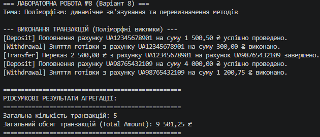

## Висновок

У ході виконання лабораторної роботи №8 було практично опановано концепцію поліморфізму та динамічного зв'язування в C#:

1. **Реалізація ієрархії:** Створено базовий клас `Transaction` з віртуальним методом `Execute()`, а також похідні класи `Deposit`, `Withdrawal` та `Transfer`, які перевизначили даний метод.
2. **Динамічне зв'язування:** За допомогою колекції `List<Transaction>` продемонстровано, що під час ітерації в циклі для кожного об'єкта викликається реалізація методу `Execute()`, яка відповідає його фактичному типу під час виконання.
3. **Агрегація результатів:** Реалізовано обчислення підсумкових показників (загальної кількості проведених операцій та сумарного обсягу грошових коштів), що підтвердило зручність обробки поліморфних об'єктів через спільний базовий інтерфейс.

